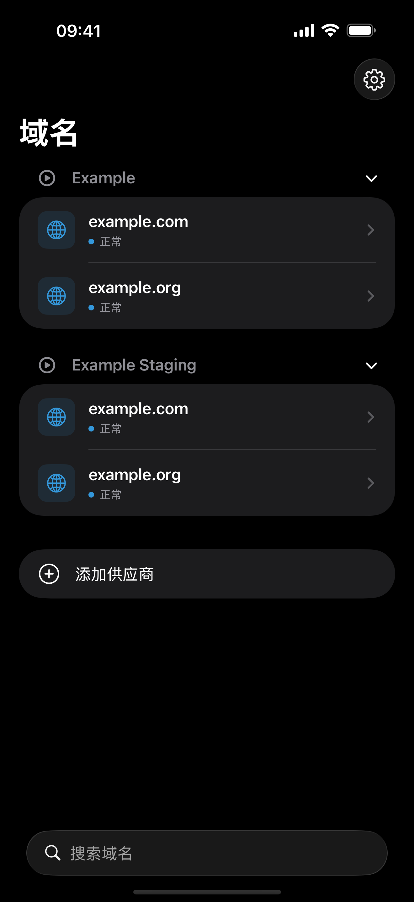
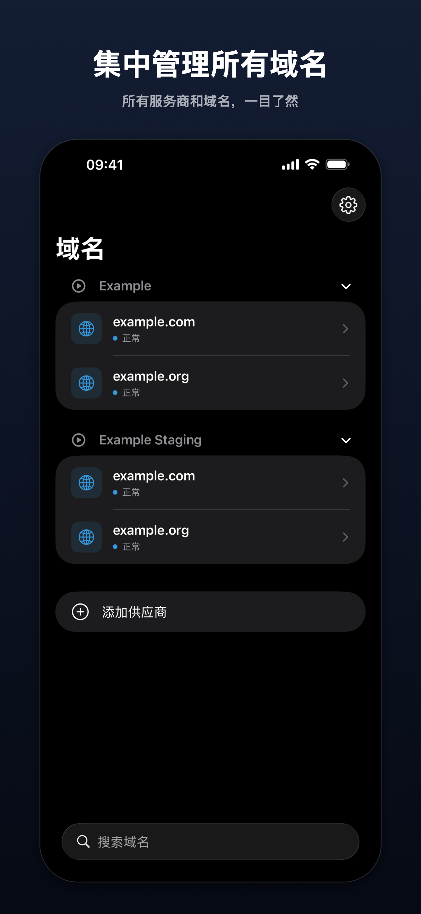
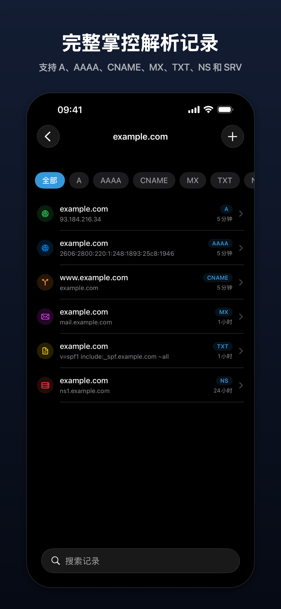
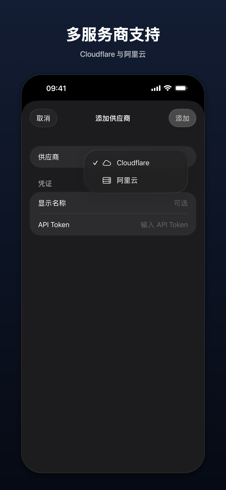
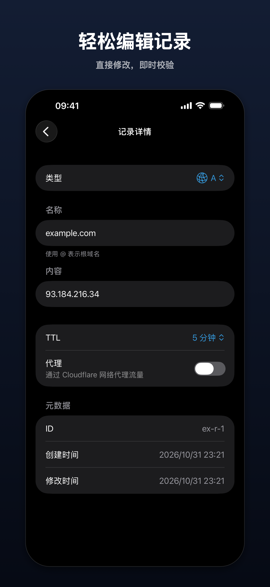
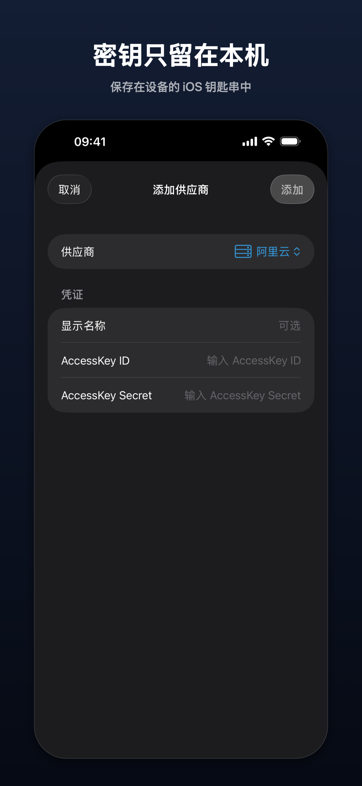

# GlassDNS

🌐 一款采用原生 Liquid Glass 设计的 iPhone 和 iPad DNS 管理应用

<div align="center"></div>

| 分类 | 技术栈            |
| ---- | ----------------- |
| 平台 | iPhone / iPad     |
| 框架 | SwiftUI           |
| 语言 | Swift 5           |
| 设计 | 原生 Liquid Glass |

## 安装

### App Store

[在 App Store 下载](https://apps.apple.com/app/id6761304344)

### 环境要求

- Xcode 26+
- iOS 26.4+
- Apple 开发者账号（真机部署）

### 从源码构建

```bash
git clone https://github.com/tlyboy/GlassDNS.git
cd GlassDNS
open GlassDNS.xcodeproj
```

在 Xcode 中选择目标设备或模拟器，按 `Cmd + R` 构建并运行。

## 使用说明

### 支持的供应商

- **Cloudflare** — API Token 认证
- **阿里云 DNS** — AccessKey ID + Secret 认证

### 快速开始

1. 启动应用，点击 **添加供应商**，或点击 **试用示例** 用示例数据体验
2. 选择 DNS 供应商（Cloudflare 或阿里云）
3. 输入 API 凭证
4. 应用验证凭证后自动加载域名列表

### DNS 记录管理

- 查看域名下所有 DNS 记录
- 按类型筛选记录（A、AAAA、CNAME、MX、TXT、NS、SRV）
- 按名称或内容搜索记录
- 添加、编辑、删除 DNS 记录，校验提示显示在对应字段旁
- 下拉刷新获取最新数据

### 特性

- **多供应商** — 在一个应用中管理多个 DNS 供应商
- **iPad** — 三栏布局，侧边栏、记录列表和详情并排显示
- **安全存储** — API 密钥存储在 iOS Keychain 中，不会离开设备
- **双语支持** — 中文和英文，可在设置中切换
- **外观** — 浅色、深色或跟随系统，原生 Liquid Glass 设计，蓝色点缀
- **无障碍** — 支持动态字体和旁白（VoiceOver）

### 截图

<p>
  
  
  
  
  
</p>

## 使用许可

[MIT](https://opensource.org/licenses/MIT) © tlyboy
